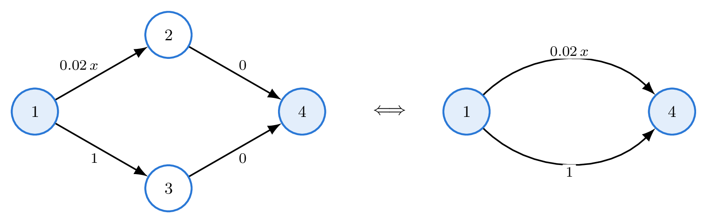
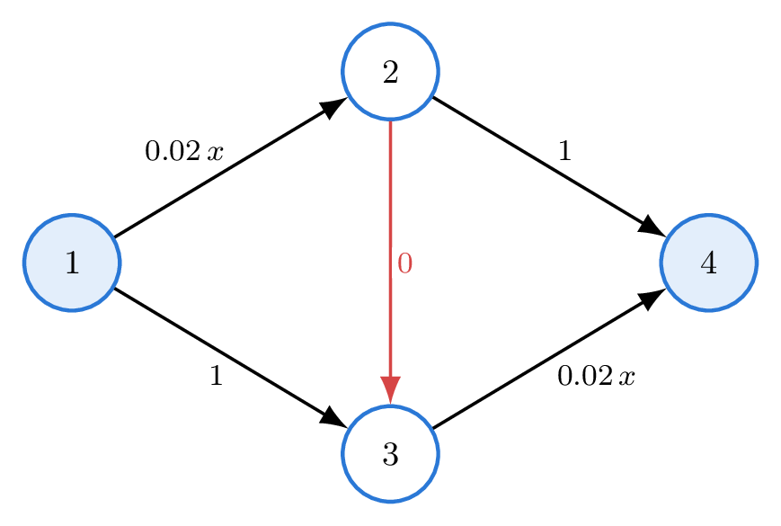
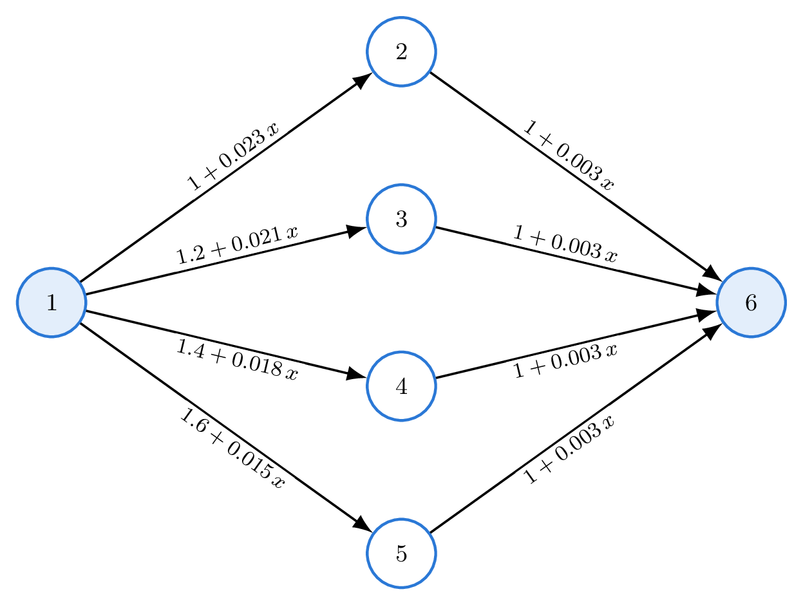
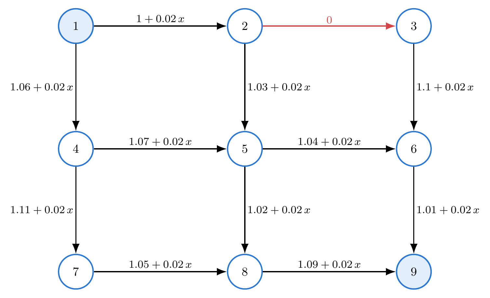
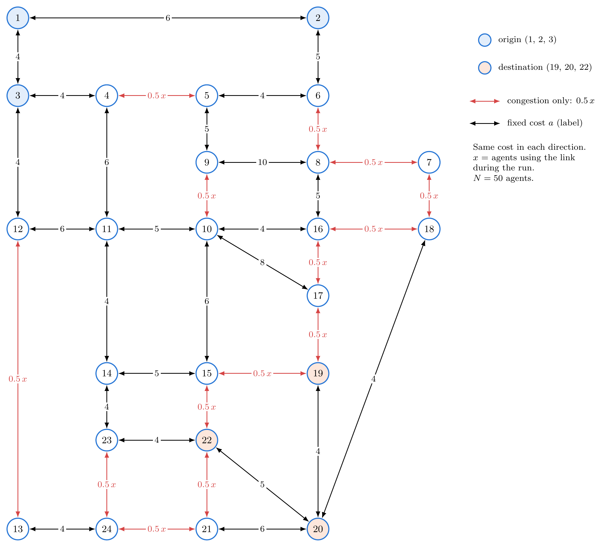

# The Value of Information in Selfish Routing

**COMP3821 — Extended Algorithm Design and Analysis**

Can knowing more about other drivers' routes make congestion worse? This project investigates how **incomplete and asymmetric information** changes individual travel costs and overall network efficiency in selfish routing games. 

This is a step-based, agent-based routing simulator, with outcomes across five networks with classical Wardrop-equilibrium and social-optimum benchmarks.

**Navigation:** [Networks & results](#networks-and-results) · [Simulation procedure](#simulation-procedure) · [Experiments](#experiments) · [Repository guide](#repository-guide) · [How to Run](SETUP.md)

## Networks and results

Each network contains **50 agents** under the standard configurations, with linear edge costs of the form $c_e(f)=a_e+b_e f$. The diagrams below show the network structures; click a result set underneath each diagram to find its plots (`.png`) and data (`.csv`).

**Which result set should I open?**

| Result set | Description |
| --- | --- |
| [`results/`](results/) | Standard information sweeps: **$\alpha$ increments of 0.05**, **200 trials per point**. Includes the optional zero-information focal-agent comparison. |
| [`results_fine/`](results_fine/) | Finer information sweeps: **$\alpha$ increments of 0.01**, **500 trials per point**. Contains the three main experiments. |
| [`results_capped/`](results_capped/) | Standard sweeps with **capped congestion estimates** (alternative information assumption). |

Every graph compares simulated mean cost per agent with the **Wardrop equilibrium** and **social optimum**, and shows 95% confidence intervals for estimated means. The three main experiment names are `symmetric`, `others_rising`, `informed_rising` and `informed_rising_half` ([definitions below](#experiments)).

### 1. Pigou's network

Two alternative routes: one has congestion-dependent cost, while the other has constant cost. This is a simple setting for seeing how imperfect information can move selfish traffic away from an inefficient equilibrium.



**Results:** [Standard](results/pigou/) · [Fine](results_fine/pigou/) · [Capped](results_capped/pigou/)

### 2. Braess' network

A small network with an additional shortcut, illustrating that individually attractive route choices need not produce the best collective outcome.



**Results:** [Standard](results/braess/) · [Fine](results_fine/braess/) · [Capped](results_capped/braess/)

### 3. Diamond network

Four parallel two-edge routes with different fixed costs and congestion slopes. This provides a controlled comparison with more route choices than Pigou's network.



**Results:** [Standard](results/diamond/) · [Fine](results_fine/diamond/) · [Capped](results_capped/diamond/)

### 4. Grid network

A directed $3\times3$ grid with multiple intersecting routes and a zero-cost edge. It lets us study how information affects routing when path choices share parts of the network.



**Results:** [Standard](results/grid/) · [Fine](results_fine/grid/) · [Capped](results_capped/grid/)

### 5. Sioux Falls network

A larger, 24-node transportation benchmark with origins at nodes **1, 2, 3** and destinations at **19, 20, 22**. Its more complex topology provides a comparison with the four small networks.



**Results:** [Standard](results/sioux_falls/) · [Fine](results_fine/sioux_falls/) · [Capped](results_capped/sioux_falls/)

The Sioux Falls network is adapted from the [Transportation Networks for Research dataset](https://github.com/bstabler/TransportationNetworks); original data files are preserved in [`scenarios/sioux_falls/source/`](scenarios/sioux_falls/source/).

## Simulation procedure

The simulation is **step-based**, but agents pay congestion costs based on **total edge usage over the completed run**, not just the agents crossing an edge in the same timestep. An agent chooses routes selfishly, seeking to minimise its *perceived* travel cost.

**At every timestep: announce routes → review and revise sequentially → move simultaneously.**

1. **Announce routes.** Every agent announces its latest full route, including edges already traversed and its currently intended remaining route. Before the first round, agents announce their shortest paths using uncongested (free-flow) edge costs. Agents that have arrived continue to announce their completed routes.
2. **Review and revise sequentially.** The agents still travelling are considered in a new random order. Under the standard settings, **every** travelling agent gets one opportunity to reconsider its route per timestep. For agent *i*, each other agent's announced full route is independently visible with probability **$\alpha_1$**. The agent uses the observed routes to estimate congestion, then finds its lowest perceived-cost remaining path using Dijkstra's algorithm. **Its revised intention is immediately announced**, so agents processed later in the same timestep can observe the new route rather than the old one. Agents processed earlier cannot react again until the next timestep.
3. **Move simultaneously.** Once all decisions are complete, every travelling agent moves **one edge** along its latest route. No agent moves while others are still revising their routes.

Repeat until every agent has arrived (or the configured timestep limit is reached). At the end, calculate each edge's total flow from the agents' **completed routes**, then charge every agent for the edges it traversed.

### Information and congestion

- **Information level $\alpha_i\in[0,1]:$** `0` means the agent observes no other agents' routes; `1` means it observes them all. Each other route is sampled independently.
- **Estimated flow:** for $\alpha_i>0$, the estimate of other agents on edge $e$ is **$K_{i,e}/\alpha_i$**, where $K_{i,e}$ is the number of observed routes containing $e$. At $\alpha_i=0$, the implementation estimates zero other agents. It adds itself when evaluating edge costs.
- **Actual edge cost:** $c_e(f_e)=a_e+b_ef_e$, where $f_e$ counts all agents whose completed route traverses edge $e$, regardless of when they crossed it.
- **Route restrictions:** by default, agents cannot revisit vertices or take an edge that moves them closer (in hop distance) to their origin. The restriction is configurable through `forward_only`.

Optional `cap_estimates` limits perceived *other-agent* flow to **N − 1**. This is a sensitivity analysis, not the primary model.

## Experiments

The default experiment runner studies three information configurations across all five networks:

| Experiment | Setup | Measures |
| --- | --- | --- |
| `symmetric` | All agents have the same $\alpha$, varied from 0 to 1. | Mean cost per agent. |
| `others_rising` | A randomly chosen focal agent stays at $\alpha=1$; all other agents' $\alpha$ rises from 0 to 1. | Mean population cost and focal-agent cost. |
| `informed_rising` | Other agents stay at $\alpha=0$; the focal agent's $\alpha$ rises from 0 to 1. | Mean population cost and focal-agent cost. |
| `informed_rising_half` | Other agents stay at $\alpha=0.5$; the focal agent's $\alpha$ rises from 0 to 1. | Mean population cost and focal-agent cost. |

Experiments use repeated random trials and report 95% confidence intervals. The **Wardrop equilibrium** is the classical selfish-routing reference, while the **social optimum** minimises total cost. Their ratio is the **price of anarchy**. Benchmark values come from the [benchmark solver](src/benchmarks/frank_wolfe.py). They use continuous demand distributed evenly across origin–destination pairs, so they are reference values rather than exact predictions for every discrete, randomly generated run.

## Repository guide

```text
README.md                       Project overview and navigation
scenarios/<network>/            Network, agent-population and simulator JSON configuration
scenarios/sioux_falls/source/   Original Sioux Falls data
src/components/                 Agent information model, networks and route choice
src/simulation/                 Simulator and scenario loader
src/experiments.py              Monte Carlo experiments, CSV output and plots
src/benchmarks/                 Wardrop and social-optimum calculations
diagrams/                       Network images, TikZ sources and build script
results/                        Standard $\alpha$ sweeps (0.05 / 200 trials)
results_fine/                   Fine $\alpha$ sweeps (0.01 / 500 trials)
results_capped/                 Capped-estimate standard sweeps
archive                         Work performed in earlier stages of the project
```